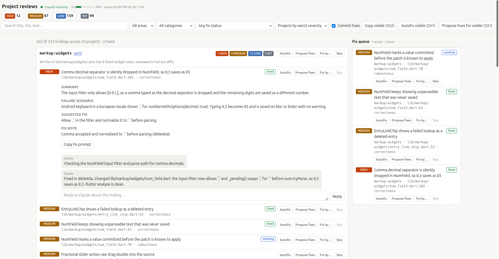

<p align="center"></p>

# Puffin skills

Claude Code skills so Puffins come to your aid.

## Quick start

```
/plugin marketplace add aukmind/puffins
/plugin install puffin@aukmind

/puffin:review review medium --agents 20
/puffin:review listen      # pick fixes one by one in the viewer
/puffin:review fix         # or fix everything at once
```

## Skills

- `/puffin:review <list|review|fix|listen|stop> [low|medium|high|xhigh|max] [--agents N] [--project NAME] [--no-commit] [extra context]`
- - `/puffin:review`: VERY fast full repo review with fixes from a web viewer. [review skill](puffins/skills/review/SKILL.md).
- - `list`: List projects and subprojects of your repo. Only tracked code files (`git ls-files`, no images, binaries, logs, data or lockfiles); ask in the extra context to widen it
- - `review`: Reviews each subproject with `/code-review` using N agents (runs list if needed)
- - `fix`: Fixes all open findings (runs review if needed): dedups them, groups them by file set and subsystem, then fixes the groups in parallel, one commit per group (`--no-commit` to skip). No re-review afterwards.
- - `listen`: Starts a web page and integration to review the changes from it (runs review if needed)
- - `stop`: Stops the server and monitoring

Fix statuses from `fix` show up in the viewer, and `needs-input` findings continue there with `listen`.



## Local hacking

    ln -s "$PWD/puffins/skills/review" "${CLAUDE_CONFIG_DIR:-$HOME/.claude}/skills/review"

## License

MIT, see [LICENSE](LICENSE).
